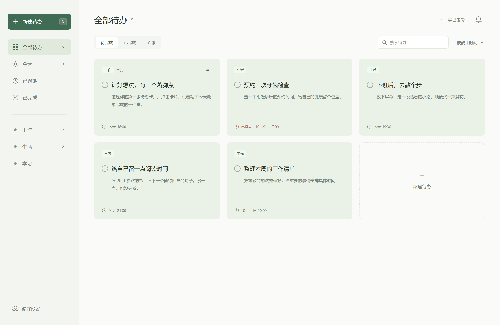

# 拾光 · Daynote

**少一点界面，多一点专注。**

一款面向 Windows 的极简本地待办软件。用卡片记录事情，为每件事设置日期时间提醒，关掉窗口后继续在托盘运行。

无需注册账号，无需搭建服务，也无需一直连接网络。任务、提醒记录和偏好设置都保存在自己的电脑上。



## 为什么做拾光

- **极简。** 去掉头像、欢迎语、目标统计和装饰标签。打开就能看待办，新建一张卡片就能开始记录。
- **本地。** 数据以 JSON 文件保存在本机，不依赖云端服务；支持导出、恢复和上一份有效数据备份。
- **运行简单。** Windows 便携版解压后双击即可使用，无需另装 Node.js、数据库或后台服务。关闭窗口后收起到托盘，提醒继续运行。
- **颜色统一。** 默认绿色；其他主题色放在偏好设置中，所有卡片统一跟随主题，也支持深色外观。

这里的“轻量”指功能、依赖和使用流程简单。桌面运行时使用 Electron，自带 Chromium 和 Node.js，因此发行包仍有一定体积；目前没有提供内存或启动速度的实测承诺。

## 快速开始

### Windows 便携版

1. 解压完整的 `Daynote-win32-x64` 文件夹到可写位置。
2. 双击其中的 **`Daynote.exe`**。
3. 点击「新建待办」，填写标题，可选设置截止时间和提醒时间。

首次启动会创建少量示例卡片，示例默认不设置提醒。请保留整个程序文件夹，不要只移动 `.exe`。便携版无需开发环境，下载完成后可离线运行。

本项目暂不附带安装器。源码仓库不存放运行程序；在本地打包，或从仓库的 [Releases](https://github.com/yxqsuperrabbit-cpu/a-lightweight-local-todo-app/releases) 下载已发布的便携包（如有）。

### 从源码运行

需要 Node.js **22.12 或更新版本**和 npm。在项目目录执行：

```powershell
npm.cmd ci
npm.cmd start
```

也可以双击 `start-demo.cmd`：存在便携版时优先启动便携版，否则启动已安装依赖的源码版本。首次安装或运行 Electron 可能需要联网下载运行时。

## 能做什么

| 功能 | 说明 |
| --- | --- |
| 卡片待办 | 新建、编辑、完成、删除，删除后 10 秒内可撤销 |
| 查找与整理 | 工作 / 生活 / 学习分类，置顶、重要优先级、搜索和排序 |
| 任务视图 | 全部、今天、逾期、已完成 |
| 日期时间提醒 | 截止与提醒时间独立；自定义时间，或截止时 / 提前 5、15、30 分钟 |
| 提醒中心 | 查看提醒、标记已读、10 分钟后再次提醒 |
| 托盘运行 | 关闭窗口后继续检查提醒；双击托盘图标恢复窗口 |
| 开机自启动 | Windows 登录后自动在托盘运行，默认关闭 |
| 外观 | 绿色、奶油、紫色、桃色、蓝色全局主题，支持深色外观 |
| 数据备份 | 本地保存、上一份有效备份、JSON 导出与导入 |

快捷键：`N` 新建待办，`/` 搜索，`Esc` 关闭弹窗。

## 提醒与开机自启动

在新建或编辑卡片时，选择「自定义日期和时间」即可安排提醒。软件每秒检查到期任务，已完成或删除的任务不再提醒；启动和休眠恢复时检查遗漏提醒。

进入左下角「偏好设置」，开启 **「开机自启动」**。下次登录 Windows 后，拾光会进入托盘，不弹出主窗口。关闭开关即可取消自启动。

启动项只在操作此开关时修改。软件读取 Windows 的实际启动状态，不会自动重新开启被系统禁用的启动项；导入备份也不会启用自启动。移动程序前请先关闭自启动，在新位置打开后重新开启。

在托盘菜单点击「退出软件」才会完全退出。完全退出、关机或尚未登录 Windows 时不会提醒；电脑休眠时不会主动唤醒。系统通知与声音受 Windows 通知设置及勿扰模式影响，可在设置中点击「发送测试」确认。

## 数据在自己手里

| 运行方式 | 待办数据 | 窗口缓存等运行数据 |
| --- | --- | --- |
| Windows 便携版 | `Daynote.exe` 同目录下的 `data/` | 同目录的 `.runtime/` |
| 源码桌面版 | 项目根目录的 `data/` | 项目根目录的 `.runtime/` |
| 浏览器预览 | 当前浏览器的本地存储 | 与桌面版数据独立 |

`data/tasks.json` 保存当前状态，`data/tasks.backup.json` 保存上一份有效数据。读取失败时尝试从备份恢复；两份文件都无效时停止加载并保留原文件，不自动清空任务。

点击「导出备份」保存 JSON 文件。设置中的「导入备份」校验格式，并在确认后替换当前任务、提醒记录和界面偏好。建议定期备份，并在移动或删除程序文件夹前导出数据。

应用运行不需要账号或远程接口。项目已忽略个人数据、依赖、缓存、测试产物和发行包；默认打包也不包含已有个人待办。

## 打包与开发

生成带自定义图标的 Windows x64 便携版：

```powershell
npm.cmd run package
```

输出：`dist/Daynote-win32-x64/Daynote.exe`。图标使用项目自己的绿色待办图形，窗口、托盘和程序图标统一。

打包目录已存在时会停止，避免覆盖其中的数据。需要携带当前源码版的个人任务时，可运行 `npm.cmd run package:local`；这种包仅供个人使用，勿作为公开发行包上传。

界面使用原生 HTML / CSS / JavaScript，桌面层使用 Electron，本地存储使用 JSON；没有前端框架和外部数据库运行依赖。

```text
pc_todo_note/
├─ assets/          自定义图标的 SVG、PNG、ICO
├─ docs/            项目计划、开发说明、便携版说明和示例截图
├─ electron/        窗口、托盘、提醒、文件存储、自启动和桌面验证
├─ scripts/         预览服务、图标生成、Windows 打包
├─ src/             界面、样式和待办数据模型
├─ tests/           数据、存储和自启动测试
├─ index.html       界面入口
├─ start-demo.cmd   Windows 启动入口
└─ package.json     开发与打包命令
```

开发命令、测试、浏览器预览和模块说明见 [开发说明](docs/DEVELOPMENT.md)。早期规划见 [项目计划](docs/PROJECT_PLAN.md)，其中未完成的路线不代表当前已实现功能。

## 当前范围

当前为可运行的早期版本，优先做好个人本地待办和日期时间提醒。尚未实现重复任务、单任务多次提醒、日历视图、桌面悬浮卡片和跨设备同步；Windows 安装器与程序签名也尚未提供。
